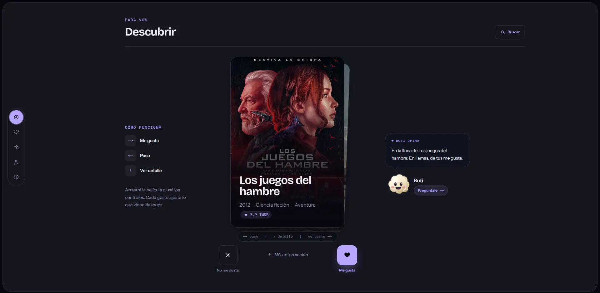

<h1 align="center">Butaca</h1>

<p align="center">
  <strong>Menos scroll. Más cine.</strong><br />
  Descubrí películas que realmente van con vos.
</p>

<p align="center">
  <a href="https://butaca.lat/"><strong>Entrá a la web oficial · butaca.lat ↗</strong></a>
</p>

<p align="center">
  <a href="https://butaca.lat/">
    
  </a>
</p>

<p align="center">
  Tu próxima película empieza con tus gustos.<br />
  <sub>Proyecto de portfolio · Solo películas · Recomendaciones basadas en contenido</sub>
</p>

<p align="center">
  <a href="#la-experiencia">La experiencia</a> ·
  <a href="#stack">Stack</a> ·
  <a href="#desarrollo-local">Desarrollo local</a> ·
  <a href="#documentación">Documentación</a>
</p>

---

## La experiencia

Elegir qué ver no debería llevar más tiempo que ver una película. **Butaca** combina tus géneros favoritos, tus reacciones y el catálogo de TMDB para ayudarte a encontrar algo que valga la pena.

| Tu recorrido | Qué encontrás |
| --- | --- |
| **Contanos qué te gusta** | Un onboarding breve con géneros y películas que ya disfrutaste. |
| **Descubrí a tu ritmo** | Tarjetas de películas, búsqueda y detalles para decidir sin perderte entre opciones. |
| **Afiná tus recomendaciones** | Cada `LIKE` o `DISLIKE` ayuda a definir lo que viene después. |
| **Preguntale a Buti** | Un asistente que conversa sobre recomendaciones usando el mismo motor de la app. |
| **Compartí tu mirada** | Reseñas para recomendar una película o contar por qué no vale la pena. |

El catálogo viene de **TMDB**. El criterio para ordenar las recomendaciones es de **Butaca**: filtrado basado en contenido, con tus preferencias y reacciones como punto de partida.

---

## Stack

| Capa | Tecnología |
| --- | --- |
| Aplicación | Next.js 16 · React 19 · TypeScript |
| Estilos y motion | Tailwind CSS 4 · Motion |
| Datos | PostgreSQL 17 · Drizzle ORM |
| Autenticación | Better Auth · sesiones en PostgreSQL |
| Correo | Resend |
| Validación | Zod 4 · contratos compartidos |
| Catálogo | TMDB |
| IA | AI SDK · Google |
| Testing | Vitest · Testing Library · Playwright |
| Ejecución local | Docker Compose |

## Arquitectura

Un **monolito modular**, con fronteras claras entre presentación, lógica de aplicación y acceso a datos:

```text
Route / Server Action
        ↓
Application Service
        ↓
Repository / Integration
```

<details>
<summary><strong>Explorar la estructura del proyecto</strong></summary>

<br />

```text
src/
├── app/            # Routes, API endpoints and application shell
├── contracts/      # Shared Zod schemas and inferred types
├── db/             # Drizzle schema and migrations
├── features/       # Domain-focused application logic
├── integrations/   # TMDB, Better Auth, and Resend integrations
├── fixtures/       # Validated development and test data
└── lib/            # Shared infrastructure utilities
```

</details>

## Desarrollo local

### Requisitos

- **Node.js 24** y **pnpm 11** para ejecutar la app sin contenedor.
- **Docker / Docker Desktop** para el stack de Compose.
- Configuración privada de PostgreSQL, Better Auth, Resend y TMDB. Google es necesario para el chat.

### Con Docker Compose

Prepará `.env` usando `.env.example` como referencia, **sin sobrescribir un archivo privado existente**. Para probar en tu máquina, usá `BETTER_AUTH_URL=http://localhost:3000`.

```bash
docker compose build web migrate
docker compose up -d --wait postgres
docker compose run --rm migrate
docker compose up -d --wait web
```

Abrí **[localhost:3000](http://localhost:3000)**. Las migraciones son explícitas: no corren al iniciar la aplicación.

Para detener el stack sin borrar sus datos:

```bash
docker compose stop
```

### Con Node.js

Con las variables y una conexión PostgreSQL local configuradas según la [guía de backend](./docs/references/foundation-backend-ops.md):

```bash
pnpm install
pnpm dev
```

> El PostgreSQL de Compose no publica su puerto al host. La [guía Docker](./docs/references/docker-deployment.md) explica la red y la configuración del stack.

## Comandos útiles

```bash
pnpm dev          # Servidor de desarrollo
pnpm lint         # ESLint
pnpm typecheck    # Verificación estricta de TypeScript
pnpm test:run     # Suite de tests con Vitest
pnpm build        # Build de producción
```

### Base de datos e integración

Las migraciones requieren una conexión explícita. Los tests de integración usan una **base aislada de prueba**, no las credenciales habituales de la aplicación:

```bash
pnpm db:generate      # Genera migraciones desde el schema de Drizzle
pnpm db:migrate       # Aplica las migraciones pendientes
pnpm db:check         # Valida la secuencia de migraciones
pnpm test:integration # Suite contra PostgreSQL de prueba; TMDB live es opt-in
pnpm test:e2e         # Flujos completos con Playwright y entorno de prueba explícito
```

> Seguí la [configuración de pruebas aisladas](./docs/references/foundation-backend-ops.md#6-pruebas) antes de ejecutar integración o E2E. Crean y eliminan datos de prueba; nunca deben apuntar a una base con datos valiosos.

## Principios del producto

- Las películas se identifican directamente por su ID de TMDB.
- Un `LIKE` o `DISLIKE` excluye la película de Discover.
- Cambiar entre `LIKE` y `DISLIKE` conserva `watchedAt`.
- Quitar una reacción conserva `watchedAt`; ambos estados son independientes.
- Las reviews no modifican las recomendaciones en V1.
- Los contratos Zod son la fuente única de verdad para frontend y backend.

## Documentación

- [`AGENTS.md`](./AGENTS.md) — Mapa operativo del proyecto, stack y convenciones para agentes.
- [`ARCHITECTURE.md`](./ARCHITECTURE.md) — Arquitectura modular, fronteras e invariantes del sistema.
- [`docs/product-specs/`](./docs/product-specs/) — Especificaciones de producto y contratos.
- [`docs/design-docs/`](./docs/design-docs/) — Decisiones técnicas y diseño de arquitectura.
- [`docs/references/`](./docs/references/) — Guías operativas de backend y despliegue Docker.
- [`docs/PLANS.md`](./docs/PLANS.md) — Protocolo y ciclo de vida de Execution Plans (ExecPlans).
- [`Guía Docker`](./docs/references/docker-deployment.md) — Arranque local, migraciones y configuración de runtime.
- [`DNS de Resend`](./docs/references/resend-dns.md) — Registros y verificación del dominio para correo transaccional.

## Calidad antes de integrar

Antes de considerar una feature terminada:

```bash
pnpm lint
pnpm typecheck
pnpm test:run
pnpm build
```

---

<p align="center">
  <strong>Encontrá tu próxima gran película.</strong><br />
  <a href="https://butaca.lat/">Nos vemos en Butaca ↗</a>
</p>
